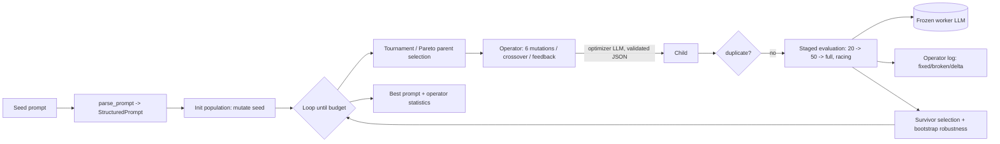

# PromptEvo

Black-box evolutionary prompt optimizer with **operator-level analysis**. The worker LLM is frozen; only prompts evolve.
Input: task description, seed prompt, small labeled dev set (50-200 examples), a budget of worker-LLM calls.
Output: best prompt, dev score, full evolution history, per-child operator log (examples fixed/broken), per-operator statistics, and baseline-comparison results.

## Research motivation
Prompt optimizers report gains but rarely say *which edits* produced them. PromptEvo splits a prompt into six slots, gives each slot its own mutation operator, and logs the effect of every child relative to its parent. This answers: (1) does evolution beat seed/manual prompts, (2) which operators matter, (3) does that depend on task, (4) worker model, (5) budget.

## Architecture

Package layout follows the spec (`prompt_evo/{schemas,core,prompts,operators,evaluation,logging,baselines,experiments}` + `llm/`, `viz.py`, `cli.py`).

## Prompt representation
`StructuredPrompt` has six slots: `instruction_wording` (list of sentences), `instruction_ordering` (permutation), `constraints`, `few_shot_examples`, `output_format`, `reasoning_instruction`, plus raw prompt, version id, parent ids, operator, generation, metadata. `serialize_prompt()` renders:
instructions / `Constraints:` / `Reasoning:` / `Output format:` / `Examples:`. `parse_prompt()` is a header heuristic; explicit JSON/YAML prompts bypass it, and unrecognized text always stays in `instruction_wording`.

## Operators
Six primary operators (one per slot): `instruction_wording`, `instruction_ordering`, `constraints`, `few_shot`, `output_format`, `reasoning`. Each sends a dedicated template (`prompts/mutation_templates.py`) to the optimizer LLM and expects `{"new_component": ..., "reason": ...}`. Replies are parsed, schema-validated and applied to a *copy* of the parent; invalid replies are retried (if optimizer budget permits, with the error fed back) and otherwise the child is discarded and logged as `invalid_mutation`. Rules: `output_format` must contain "answer" (harness compatibility); orderings must be permutations; few-shot ids must exist in the pool; no-op edits are rejected.
**Crossover**: LLM combines two parents into a full child; slot provenance (A/B/new) is recorded; children identical to a parent are rejected. **Feedback** (optional, `feedback_probability`, default 0): revises a prompt from failed examples; excluded from the six-operator ablations.

## Evaluation, budget, selection
- `Evaluator`: per-example `ExampleResult`, accuracy, latency, tokens, cost; deterministic; metrics for classification / math (numeric, fractions) / QA (EM + contiguous containment); answer extraction from `Answer: x` or JSON. (prompt, example) results are cached (valid at temperature 0) so promotions never pay twice.
- `BudgetManager`: hard cap on **worker** calls (checked before every call); optimizer calls tracked separately; optional cost pricing.
- Cheap evaluation: nested seeded slices (`initial_slice_size`, `promotion_slice_size`, full dev); a child is promoted only if its slice accuracy >= reference - `promote_tolerance`; reference = parent's accuracy on the same examples (`racing.reference: best` uses the incumbent). **Racing** stops a child when it cannot reach the reference (bound rule) and/or its Wilson upper bound is below it. Only fully dev-evaluated children enter the population.
- `fitness = accuracy - length_penalty * len(prompt)/max_prompt_chars`; raw accuracy is always stored.
- Selection: tournament (default) or Pareto (accuracy, length, bootstrap std); survivors by (mu+1) truncation. Score = fitness - `robust_penalty` * bootstrap std.
- Bootstrap: each individual's per-example outcomes are resampled (`bootstrap_samples`) -> mean/std/95% CI (no extra worker calls).
- Optional **Thompson-sampling** operator selection (`adaptive: true`); default is fixed weights so ablations stay valid.

## Operator logging (core contribution)
Every attempt -> `OperatorLogEntry` (`operator_log.jsonl/csv`): child_id, parent_ids, generation, operator, status, before/after score and accuracy, score_delta, examples_fixed / examples_broken (ids), examples_unchanged (count), prompt lengths, worker/optimizer calls, timestamp, component before/after, change description. Deltas are **paired** with the parent on the same evaluated examples. `compute_operator_stats` reports per operator:
`attempts`, `evaluated`, `n_wins` (score_delta > 0), `win_rate` = wins/evaluated, `success_rate` = evaluated/attempts (valid, non-duplicate, evaluable), `accept_rate`, mean/median score delta, mean accuracy delta, bootstrap 95% CI, Wilson CI for win rate, avg fixed/broken. Two views are saved: `all_evaluated` (includes children stopped by racing/promotion, evaluated on partial slices) and `full_eval_only`. Caveat: partial-slice children are mostly losers by construction, so `all_evaluated` is pessimistic; compare both.

## Baselines
Seed; Manual (reported *unavailable* if no manual prompt is configured); Basic genetic (EvoPrompt-style whole-prompt LLM mutation/crossover, full-dev evaluation, raw-accuracy truncation selection, no slots/racing/analysis); PromptEvo. All use the same worker, dev/test sets, worker-call budget and seeds. The test set is only used for final reporting (separate unlimited budget) and never for selection.

## Experiments (`prompt_evo experiment --kind ...`)
A: four methods x seeds, mean/std/t-CI, improvement over seed, calls, length, paired permutation + Wilcoxon + Cohen's d_z over test examples. B1: single-operator runs. B2: leave-one-operator-out vs full (same seeds), contribution + t-CI + paired bootstrap CI. C: tasks x workers x budgets, reports best operator per cell and whether it varies. `transfer`: evolve on worker A, evaluate seed/evolved on worker B.

## Install & run
```bash
pip install -e ".[openai,dev]"          # python >= 3.11
python -m scripts.make_toy_data          # regenerate toy data (already in data/)
pytest -q
# offline toy run (simulated worker/optimizer from tests/fakes.py, no API key):
python -m prompt_evo.cli optimize   --config configs/example.yaml
python -m prompt_evo.cli experiment --config configs/example.yaml --kind A
python -m prompt_evo.cli experiment --config configs/experiment.yaml --kind all
python -m prompt_evo.cli analyze    --results results/toy_suite --plots
python -m prompt_evo.cli baseline   --method genetic --config configs/example.yaml
python -m prompt_evo.cli evaluate   --prompt prompts/classification_manual.txt --dataset data/classification_test.jsonl --config configs/example.yaml
```
Results land in `results/<name>/`: `config.json` (seed, models, dataset hashes, budget, probabilities, git commit, full config), `evolution.jsonl`, `operator_log.{jsonl,csv}`, `operator_stats.{json,csv}`, `final_population.{json,csv}`, `summary.json`, `per_example_results.json`, `plots/`.

## Connecting a real LLM
Set `provider: openai`, `model`, optionally `base_url` (any OpenAI-compatible endpoint) and `api_key_env` in the `worker:` and `optimizer_llm:` sections, `export OPENAI_API_KEY=...`, and point `task:` at your dev/test files (JSON/JSONL/CSV with `id,input,expected_output`). Only `prompt_evo/llm/openai_compat.py` is provider-specific; other providers: subclass `WorkerModel` / `OptimizerModel` and use `provider: custom, class_path: pkg.mod:Class`. Use temperature 0 for the worker (the cache assumes determinism); set `cache: false` otherwise. Set `price_per_1k_*` for cost tracking.

## Interpreting results
Toy numbers come from a *simulated* worker whose accuracy is a hand-written function of prompt features; they verify the pipeline, not real LLM behaviour. On real runs, trust operator conclusions only when CIs exclude 0; with 3 seeds the B2 t-intervals are wide. Use more seeds and a larger dev set.

## Limitations
Few-shot examples default to being drawn from the dev set (leakage into dev scores) - supply `task.fewshot_pool`. Dev sets of ~60 make slice/racing estimates noisy. Operator deltas confound with crossover/selection state. Only exact/normalized-match metrics. Sequential evaluation (no concurrency). Real-API code path is untested here (no network/keys). The optimizer cannot verify that wording edits preserve semantics.

## Future work
LLM-judge metrics, parallel evaluation, operator interaction (pairwise) analysis, semantic-equivalence checks for wording edits, cross-task operator priors.
